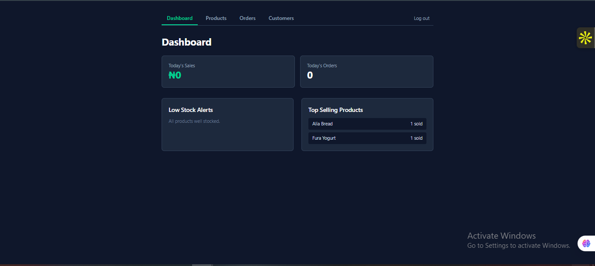
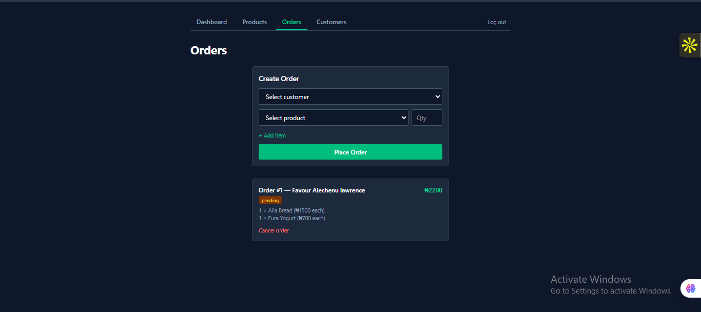
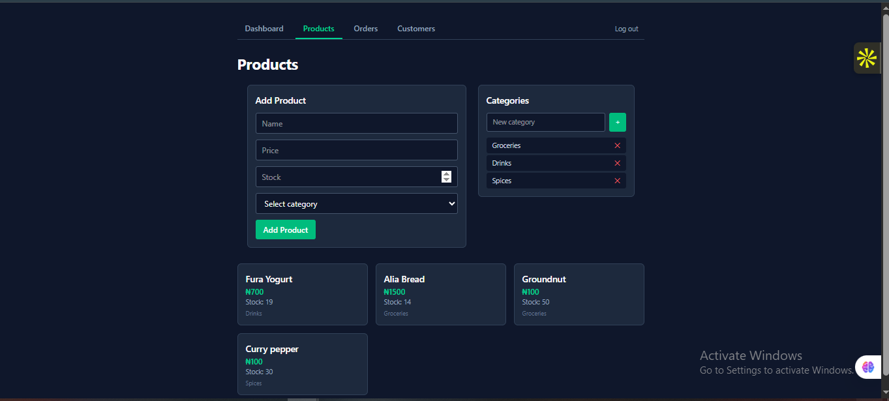
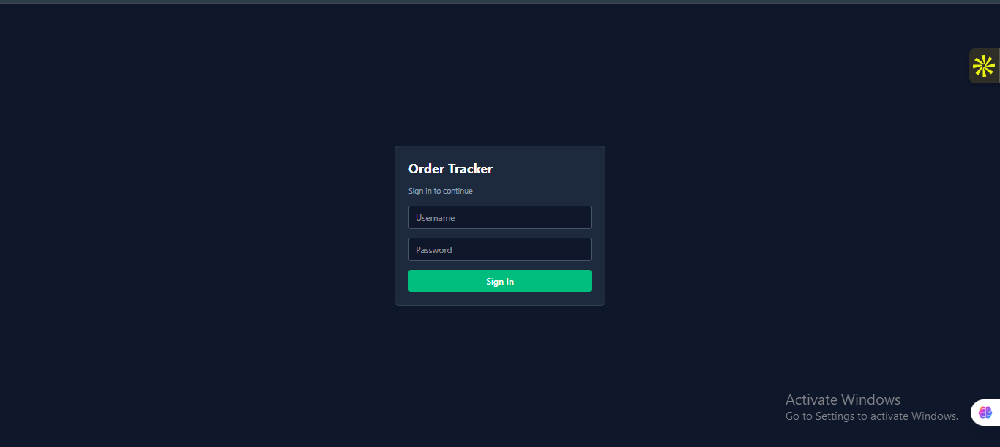

# Order & Inventory Tracker

A full-stack order and inventory management system for small businesses, such as a local shop or market stall, that need something more reliable than a notebook or scattered spreadsheets to track products, stock, customers, and orders.

**Live app:** https://order-tracker-eight-rouge.vercel.app (login required, see [Access](#access))
**API docs:** https://order-tracker-api-qw4w.onrender.com/docs

> The backend runs on Render's free tier, which spins down after inactivity. The first request after an idle period can take 30 to 60 seconds while it wakes up.

## Screenshots

| Dashboard | Orders |
|---|---|
|  |  |

| Products | Login |
|---|---|
|  |  |

---

## The problem

Small businesses often track orders and stock in a notebook, a WhatsApp chat, or an Excel sheet. These methods don't prevent basic mistakes:

- Selling something that is already out of stock
- Losing track of what a customer ordered or paid
- Not knowing at a glance what needs restocking
- Counting the day's sales by hand

This project replaces that with a system that enforces correctness automatically:

- **Stock updates itself.** Placing an order deducts stock, and cancelling restores it.
- **Orders can't oversell.** An order is rejected if any item lacks enough stock.
- **A dashboard answers the daily questions:** today's sales, today's order count, what is running low, and what sells best.
- **History stays accurate.** Each order item stores the price at the time of sale, so a later price change doesn't rewrite past orders.
- **Only the owner can change data.** Every route except login is protected.

---

## Features

- Categories and products with full CRUD
- Customers
- Multi-item orders with atomic stock deduction
- Order cancellation with stock restoration, plus guards against double-cancelling or cancelling a delivered order
- Order status tracking: pending, paid, delivered
- Dashboard: today's sales, today's order count, low-stock alerts, top-selling products (a SQL join, group by, and sum)
- **Authentication:** password hashing with bcrypt, JWT login tokens, protected API routes, and a React login page with automatic logout when a token expires
- A category that still has products cannot be deleted
- Automated backend tests (pytest) for the core logic and for the access rules

---

## Tech stack

**Backend:** FastAPI, SQLAlchemy, PostgreSQL in production and SQLite locally, bcrypt, python-jose (JWT), pytest. Hosted on Render.

**Frontend:** React, Vite, Tailwind CSS. Hosted on Vercel.

---

## Design decisions

- **Order creation is one database transaction.** Every item's stock is checked before anything is written. If any item fails, nothing is committed, so there are no partial orders and stock never goes negative.
- **`unit_price` is stored per order item,** not read from the live product price.
- **Dashboard aggregation runs in the database,** not in Python, so it stays efficient as orders grow.
- **Passwords are never stored in plain text.** They are hashed with bcrypt. Login returns the same generic error for an unknown username and for a wrong password, so the API doesn't reveal which usernames exist.
- **Registration is open for the first account only.** After the owner account exists, `/register` returns `403`, so strangers cannot create accounts.
- **Secrets live in environment variables,** not in the code.
- **A login check runs before every protected route** through a shared dependency, so a new route can't be left unprotected by accident, and a test verifies this.

---

## Access

The live app is private: only the owner account can log in, and registration is closed after the first account. To try it yourself, run it locally (below) and register your own account.

---

## Running it locally

### Backend
```bash
cd backend
python -m venv venv
venv\Scripts\activate          # Windows
# source venv/bin/activate     # macOS/Linux
pip install -r requirements.txt
uvicorn main:app --reload
```
The API runs at `http://127.0.0.1:8000`, with interactive docs at `/docs`.

Create the owner account once:
```bash
curl -X POST http://127.0.0.1:8000/register \
  -H "Content-Type: application/json" \
  -d '{"username": "owner", "password": "choose-a-strong-password"}'
```

### Frontend
```bash
cd frontend
npm install
npm run dev
```

### Tests
```bash
cd backend
pytest -v
```

### Environment variables

| Variable | Where | Purpose |
|---|---|---|
| `DATABASE_URL` | Backend | PostgreSQL connection string. Falls back to local SQLite if unset. |
| `SECRET_KEY` | Backend | Signs login tokens. Use a long random value in production. |
| `VITE_API_URL` | Frontend | The backend URL. Falls back to `http://127.0.0.1:8000` locally. |

---

## Known limitations

This is a learning project and portfolio piece. A production deployment for a real business would need to close these gaps:

- **Single account, no roles.** There is one owner login. There are no separate roles, such as a cashier who can take orders but not delete products.
- **No password reset or change flow.**
- **Login tokens last 24 hours and are stored in the browser's `localStorage`.** There is no refresh-token rotation or server-side revocation, and `localStorage` is exposed to cross-site scripting. HTTP-only cookies would be safer.
- **No rate limiting on login,** so repeated password guessing is not throttled.
- **No real payment processing.** "Paid" is a status label set by hand.
- **No tax, discount, or multi-currency support.**
- **No locking for simultaneous orders.** The order transaction is atomic, but two people buying the last unit at the same instant is not handled explicitly.
- **No audit trail.** The system shows current state, not who changed what.
- **No search, pagination, or image uploads,** which is fine for a small catalog but not for thousands of products.
- **No notifications** such as order confirmations or low-stock alerts.
- **Free-tier hosting.** The backend sleeps when idle, and the free database has storage limits.

---

## What I learned

- Designing a relational schema with foreign keys, and writing a genuinely atomic transaction with rollback on failure
- Securing an API: password hashing, JWTs, protected routes, and closing the registration endpoint
- Testing both behavior and access rules automatically instead of clicking through the docs
- Connecting a React frontend to a FastAPI backend across two separately deployed services, including CORS and environment variables
- Debugging real problems: a `passlib`/`bcrypt` incompatibility, `psycopg` driver differences between SQLite and PostgreSQL, a 500 caused by legacy rows that failed response validation, and a `.gitignore` in the wrong folder that let local database files reach the repo

---

## Author

Built by Favour, Computer Science student at Federal University of Lafia (FULAFIA).
